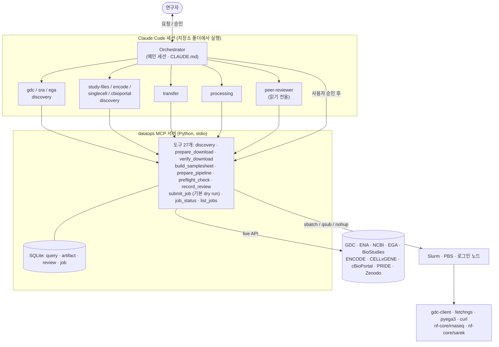

> *지게는 무거운 짐을 등에 지고 나르던 우리 전통 운반 도구입니다. 이 지게는 공공 데이터 저장소의 데이터를 연구실 HPC로 실어 나릅니다.*

# Jige(지게): Genomics DataOps Team

[](https://github.com/Sejung98/Jige/actions/workflows/tests.yml)
[](LICENSE)

**자연어로 요청하면 공공 생물학 데이터를 찾고, 연구실 HPC에서 검증된 job으로 내려받고, nf-core 파이프라인까지 준비합니다. 모든 숫자는 실제 API 조회 결과에서 나오고, 사용자 승인 없이는 아무것도 실행하지 않습니다.**

[English README](README.md)

## 바로 시작

Linux HPC 로그인 노드, Python ≥ 3.10, `curl`, [Claude Code](https://code.claude.com/docs)(Claude 구독 또는 API 키)가 필요합니다.

```bash
git clone https://github.com/Sejung98/Jige.git
cd Jige && ./install.sh          # .venv 생성, Python 의존성 설치, config.example.yaml → config.yaml 복사
vi config.yaml                   # 스케줄러, 파티션, 데이터 경로 (아래 "설정" 참고)
claude                           # 이 폴더에서 Claude Code 실행. 폴더 신뢰와 dataops MCP 서버 사용을 허용
```

그다음 이렇게 물어보면 됩니다: *"TCGA-BRCA의 WGS BAM 중 open access인 것 몇 개, 몇 TB인지 알려줘"*

다운로드·파이프라인 job에는 `gdc-client`, `pyega3`, Nextflow ≥ 25.10.4(Java 17+)와 기관의 Singularity/Apptainer도 필요합니다. 앞의 세 가지는 `conda env create -f environment.yml`로 함께 검증한 버전을 설치할 수 있습니다.

## 받아올 수 있는 데이터베이스

<table>
<tr>
<td align="center" width="25%"><a href="https://portal.gdc.cancer.gov/"></a><br><sub><b>NCI GDC</b><br>TCGA · TARGET · CPTAC</sub></td>
<td align="center" width="25%"><a href="https://www.ncbi.nlm.nih.gov/"></a><br><sub><b>NCBI SRA · GEO · dbGaP</b><br>원시 read · 처리 파일 · 보호 데이터</sub></td>
<td align="center" width="25%"><a href="https://www.ebi.ac.uk/ena/browser/"></a><br><sub><b>ENA</b><br>원시 read (INSDC)</sub></td>
<td align="center" width="25%"><a href="https://www.ddbj.nig.ac.jp/"></a><br><sub><b>DDBJ</b><br>원시 read (INSDC)</sub></td>
</tr>
<tr>
<td align="center"><a href="https://ega-archive.org/"></a><br><sub><b>EGA</b><br>controlled 인간 데이터</sub></td>
<td align="center"><a href="https://www.ebi.ac.uk/biostudies/arrayexpress"></a><br><sub><b>ArrayExpress</b><br>기능 유전체</sub></td>
<td align="center"><a href="https://www.encodeproject.org/"></a><br><sub><b>ENCODE</b><br>조절 유전체</sub></td>
<td align="center"><a href="https://cellxgene.cziscience.com/"></a><br><sub><b>CZ CELLxGENE</b><br>단일세포 h5ad</sub></td>
</tr>
<tr>
<td align="center"><a href="https://www.cbioportal.org/"></a><br><sub><b>cBioPortal</b><br>처리된 암 유전체</sub></td>
<td align="center"><a href="https://www.ebi.ac.uk/pride/"></a><br><sub><b>PRIDE</b><br>프로테오믹스</sub></td>
<td align="center"><a href="https://zenodo.org/"></a><br><sub><b>Zenodo</b><br>DOI로 공개된 논문 데이터</sub></td>
<td align="center"><a href="https://nf-co.re/"></a><br><sub><b>nf-core</b><br>rnaseq · sarek · fetchngs</sub></td>
</tr>
</table>

여기에 더해 직접 지정한 공개 HTTPS 파일(Ensembl/GENCODE 레퍼런스, gnomAD, 1000 Genomes 등)도 `url_inspect`로 받을 수 있습니다.
<sub>로고는 각 기관의 상표이며 지원 대상을 표시하는 용도로만 씁니다([출처](docs/logos/SOURCES.md)).</sub>

## 요청하면 이렇게 진행됩니다

줄인 예시입니다. 숫자는 2026-10-30 [벤치마크 실행](benchmarks/REPORT.md) 결과입니다.

```
사용자: TCGA-BRCA의 WGS BAM 중 open access인 것 몇 개, 몇 TB인지 알려줘
Jige:   gdc-discovery → gdc_search_files(project="TCGA-BRCA", experimental_strategy="WGS", data_format="BAM")
        open: 0개 · controlled: 2,106개, 536.67 TB, 952명
        + query_id와 실제로 보낸 POST https://api.gdc.cancer.gov/files 필터. 다운로드는 하지 않음.

사용자: ENCODE ENCSR356KRQ의 GRCh38 peak 파일 받아줘
Jige:   encode-discovery → bed 파일 12개, 95.87 MB, 모두 md5 있음 → manifest
        transfer → curl job 스크립트 → peer-reviewer: PASS → "이 job을 제출할까요?"
사용자: 진행해
Jige:   submit_job(confirm=True) → job 완료 → verify_download: 12/12개, md5 12/12 PASS
```

LLM은 계획과 파라미터만 만듭니다. 다운로드와 계산은 검증된 도구(gdc-client, nf-core/fetchngs, pyega3, curl, nf-core 파이프라인)가 스케줄러 job으로 수행합니다.

## 그냥 채팅 LLM에 물어보면 안 되나

같은 작은 요청 다섯 개로 Jige와 일반 채팅 LLM(같은 모델, 도구 없음)을 비교했습니다([보고서](benchmarks/REPORT.md)).

- Jige는 다섯 요청 모두 실제 API로 답했고 파일 이름·크기·체크섬까지 냈습니다. 일반 LLM은 숫자 하나만 맞혔고 파일 단위 정보는 내지 못했습니다.
- 일반 LLM이 준 다운로드 명령을 고치지 않고 그대로 실행하면 4건 중 1건만 원하는 파일을 받았습니다. 한 건은 404 페이지를 `.bed.gz` 이름으로 오류 없이 저장했고, 한 건은 `robots.txt`만 받고 종료 코드 0으로 끝났고, 한 건은 없는 paired-end 파일 이름을 가정해 실패했습니다. Jige는 요청된 세 데이터셋을 모두 받고 검증했습니다(크기, 저장소가 제공하면 md5까지).
- 일반 LLM은 실제로 있는 accession(SRR390278)을 잘 알려진 다른 번호의 오타로 짐작했습니다. Jige는 먼저 조회합니다.

## 무엇이 달라지나

| 단계 | 지금 손으로 하는 일 | Jige가 하는 일 |
|---|---|---|
| 데이터 찾기 | 포털 필터 클릭, GEO→SRA 매핑, 파일 크기 합산 | 물어보면 API에서 나온 답과 사용한 쿼리를 보여줌 |
| 다운로드 | manifest, 클라이언트 옵션, sbatch 작성. 계산 노드가 오프라인이면 막힘 | 스크립트 자동 생성, 인터넷 되는 노드(계산/전송 파티션/로그인 노드)로 자동 배치 |
| 확인 | 누락·잘린 파일, md5를 일일이 | manifest 대조, 크기·md5/sha 검사, 이어받기 재실행 |
| samplesheet | 수백 행 CSV를 손으로, paired/single 실수 | rnaseq·sarek 스키마로 자동 생성 |
| 파이프라인 | 버전·레퍼런스·profile·work dir·-resume을 매번 | 버전 고정 스크립트 + 사이트 config |
| 실수 잡기 | 보통 며칠 뒤 | 제출 전에: 종·레퍼런스 불일치, mate 누락, 디스크, controlled 취급 |
| 기록 | "그때 어떤 버전 받았더라?" | 모든 조회·스크립트 해시·검수·job이 SQLite에 |
| 모니터링 | squeue와 로그 뒤지기 | "어제 job 어때?" → 상태와 오류 요약 |

하지 않는 일: 하류 통계 분석과 생물학적 해석, DAC/dbGaP 승인 신청, 계산 자원 제공.

## 동작 구조



### 안전장치

| 원칙 | 강제 방법 |
|---|---|
| 역할 분리 | subagent의 `tools`에 자기 MCP 도구만. discovery는 다운로드 불가, transfer·processing은 제출 불가, reviewer는 판정 기록 외 읽기 전용 |
| 근거 기반 | 모든 discovery 결과에 `query_id`와 실제 API 호출(`api_queries`)이 붙고 SQLite에 저장. 숫자는 도구 결과로만 보고 |
| 추론과 실행 분리 | 스크립트는 테스트된 Jinja2 템플릿으로 생성. `.claude/settings.json`이 Claude의 셸에서 `sbatch`·`qsub`·`srun`·`salloc`·`nextflow run`·`gdc-client`·`pyega3` 실행과 크리덴셜 파일 읽기를 막음. 이 폴더에서 연 Claude 세션에만 적용되는 보조 장치이고, 실제 방어는 아래 서버 검사 |
| 승인 후 실행 | `submit_job` 기본 `dry_run=True`. 실제 제출은 `confirm=True` + `dry_run=False` + **스크립트와 입력 전체의 sha256**과 일치하는 검수 PASS + 동시 실행 한도 미만. 또 Claude Code가 `submit_job` 호출마다 사람에게 승인을 물음 |
| controlled 데이터 | DAC 승인·기관 규정·저장 위치 확인(acknowledge) 필수, 토큰·키는 경로로만 전달(내용 안 읽음), 권한 600 점검, `umask 077`, 로그 마스킹 |

자동 검수(`preflight_check`)가 잡는 것: 입력 종 ≠ 레퍼런스 종, 정렬 BAM assembly ≠ 레퍼런스(예: GDC GRCh38.d1.vd1 vs sarek 기본 GATK.GRCh38), paired 메타데이터인데 mate 누락, sex가 필요한 sarek 도구인데 NA, 디스크 부족, 버전 미고정, 오프라인 계산 노드에서 iGenomes, 생성 후 수정된 스크립트·입력.

## 설정

`install.sh`는 `.venv`를 만들고 `mcp`, `httpx`, `pyyaml`, `jinja2`, `pytest`, `respx`를 설치합니다. 이어서 `config.example.yaml`을 `config.yaml`(권한 600)로 복사하고, MCP 서버가 뜨는지 확인하고, 없는 외부 도구를 알려줍니다(직접 설치하지는 않음). 채울 항목은 다음과 같습니다.

| 항목 | 설명 |
|---|---|
| `scheduler` | `slurm` / `pbs` / `local` |
| `partition`, `account` | 기본 파티션(큐)과 과금 계정 |
| `transfer_node_mode` | 다운로드 실행 위치: `compute`(계산 노드 인터넷 가능) / `dtn`(전송 파티션) / `login` |
| `transfer_partition` | `dtn`일 때만 |
| `container` | `singularity` / `apptainer` / `docker` |
| `data_root`, `work_dir`, `singularity_cache` | 대용량 스토리지 경로 |
| `gdc_token_path`, `ega_credentials_path`, `dbgap_key_path` | controlled 데이터용 크리덴셜 **경로** (`chmod 600`) |
| `tools`, `module_loads` | job 안에서 gdc-client/pyega3/nextflow가 PATH에 없을 때 경로와 준비 명령 |
| `references` | 로컬 fasta/gtf와 `assembly`, `species` (계산 노드가 오프라인이면 필수) |

계산 노드 인터넷 확인: `srun --pty curl -sI https://api.gdc.cancer.gov/status`. SRA·GEO 조회가 많으면 `claude` 실행 전에 `NCBI_API_KEY`를 export 하세요. NCBI는 키가 있으면 초당 10회, 없으면 3회까지 받고, Jige는 그 간격에 맞춰 요청합니다.

## 다른 예시

| 요청 | 경로 |
|---|---|
| "PRJNA… RNA-seq 받아서 nf-core/rnaseq 돌려줘" | `sra_search` → 사용자 확인 → fetchngs job → 검수 → 승인 → 제출 → `verify_download` → `build_samplesheet` + `prepare_pipeline` → 검수 → 승인 → 제출 |
| "GSE…의 count matrix 받아줘" | `geo_files` → curl job (크기 검증; GEO는 체크섬 없음) |
| "K562 CTCF ChIP-seq peak, GRCh38" | `encode_search` → `encode_files(assembly="GRCh38", output_type=…)` → md5 검증 curl job |
| "COVID-19 폐 단일세포 데이터셋" | `cellxgene_search(tissue="lung", disease="COVID-19")` → h5ad manifest |
| "이 목록 환자들의 WGS BAM" (TCGA 바코드 또는 GDC case UUID) | `gdc_search_files(..., case_file=…)` → 환자 묶음마다 manifest, `summary.case_filter`에 파일이 없는 환자 표시 |
| "TCGA 유방암 변이·임상 표" | `cbioportal_search(keyword="breast")` → study tarball, hg19/hg38 표시 |
| "PXD… 파일" / "10.5281/zenodo.… 데이터" | `pride_files` / `zenodo_files` → md5 검증 curl job |
| "phs… dbGaP 승인 받았어" | `sra_search`가 보호 run 표시 → `prepare_download(use_dbgap=True)` + `.ngc` 키 |
| "어제 제출한 job 상태 알려줘" | `list_jobs(since_hours=48)` + `job_status` → 상태와 로그 오류 요약 |

<details>
<summary><b>지원 데이터베이스 상세</b></summary>

| 데이터베이스 | 받을 수 있는 것 | 접근 | 다운로드 방식 | 담당 subagent |
|---|---|---|---|---|
| NCI GDC | 정렬 BAM, 변이(VCF/MAF), 발현 count, 메틸화, CNV, 임상 | open + controlled(dbGaP) | gdc-client | `gdc-discovery` |
| SRA / ENA / DDBJ | run 단위 FASTQ (모든 생물종·assay) | open | nf-core/fetchngs | `sra-discovery` |
| NCBI GEO → SRA | GSE/GSM 뒤의 원시 read | open | nf-core/fetchngs | `sra-discovery` |
| dbGaP (SRA 경유) | 보호된 인간 run | controlled | fetchngs `--dbgap_key` (.ngc, SRA Toolkit) | `sra-discovery` |
| EGA | 데이터셋별 BAM/CRAM/VCF/FASTQ | controlled | pyega3 | `ega-discovery` |
| NCBI GEO (파일) | supplementary, series matrix (count matrix, 마이크로어레이, RAW.tar) | open | curl manifest | `study-files-discovery` |
| ArrayExpress | 처리 데이터, MAGE-TAB (원시 read는 ENA 링크) | open | curl manifest | `study-files-discovery` |
| ENCODE | peaks, signal track, alignment, FASTQ | open | curl manifest (md5) | `encode-discovery` |
| CZ CELLxGENE | 표준화된 단일세포 AnnData(.h5ad) | open | curl manifest | `singlecell-discovery` |
| cBioPortal | study별 변이·CNA·발현·임상 | open | curl manifest (study tarball) | `cbioportal-discovery` |
| PRIDE | 원시 spectra, 검색 결과 | open | curl manifest (md5) | `study-files-discovery` |
| Zenodo | DOI로 공개된 모든 데이터 | open | curl manifest (md5) | `study-files-discovery` |
| 직접 URL | 레퍼런스, gnomAD, 1000 Genomes 등 | open | curl manifest | `study-files-discovery` |

에이전트는 `list_databases` 도구로 이 카탈로그와 지원하지 않는 자원(및 이유)을 실행 중에 확인합니다.

</details>

<details>
<summary><b>공공 데이터를 받는 데 이 정도면 충분한가</b></summary>

시퀀싱 중심 유전체 연구 기준으로 주요 공개 경로는 덮습니다. 원시 read 아카이브 전부(INSDC 세 곳은 서로 미러링), 대형 controlled 인간 아카이브 두 곳과 dbGaP 보호 SRA, 주요 암·기능·조절·단일세포 자원, 그리고 논문이 처리 파일을 올리는 곳들입니다.

| 데이터 종류 | 지원 | 아직 미지원 |
|---|---|---|
| 원시 시퀀싱 read | SRA, ENA, DDBJ, GEO→SRA | 중국 NGDC GSA (공개 파일은 `url_inspect`로 가능) |
| controlled 인간 유전체 | GDC controlled, EGA, dbGaP 보호 SRA | UK Biobank, All of Us, AnVIL/Terra (클라우드 분석 환경 전용), JGA |
| 암 유전체 | GDC(원자료·하모나이즈), cBioPortal(처리 데이터) | ICGC: 데이터 포털이 2024년 6월 종료, 기존 원자료는 주로 EGA |
| 발현·기능 유전체 | GEO 파일, ArrayExpress | Expression Atlas, Single Cell Expression Atlas |
| 조절 유전체 | ENCODE | Roadmap, 4DN, IGVF |
| 단일세포 | CELLxGENE | HCA Data Portal, Broad Single Cell Portal |
| 프로테오믹스 | PRIDE | MassIVE, jPOST |
| 레퍼런스·집단 변이 | `url_inspect` (Ensembl, GENCODE, UCSC, gnomAD, 1000 Genomes) | — |
| 대사체, 이미징 | — | MetaboLights, Metabolomics Workbench, TCIA, IDR |

새 저장소는 쉽게 추가됩니다. discovery 모듈은 URL manifest(`url, filename, size, checksum`)만 만들면 되고, 다운로드·검증·검수·제출은 공통입니다.

</details>

<details>
<summary><b>MCP 도구 (27개)</b></summary>

| 그룹 | 도구 |
|---|---|
| 카탈로그·환경 | `list_databases`, `check_environment` |
| GDC | `gdc_search_files`, `gdc_search_cases`, `gdc_get_field_values` |
| SRA / ENA / GEO read / dbGaP | `sra_search` |
| EGA | `ega_search` |
| 연구 첨부 파일 | `geo_files`, `arrayexpress_files`, `pride_files`, `zenodo_files`, `url_inspect` |
| 포털 | `encode_search`, `encode_files`, `cellxgene_search`, `cbioportal_search` |
| 기록 | `get_query`, `list_queries` |
| 전송 | `prepare_download`, `verify_download` |
| 처리 | `build_samplesheet`, `prepare_pipeline` |
| 검수 | `preflight_check`, `record_review` |
| 실행 | `submit_job`, `job_status`, `list_jobs` |

</details>

## 테스트

```bash
.venv/bin/python -m pytest -q            # 단위 테스트 (HTTP는 respx mock, 일부는 실제 API 응답 캡처 사용)
.venv/bin/python -m pytest -m live -s    # 실제 API 스모크 테스트 (인터넷 필요)
```

단위 테스트는 push마다 GitHub에서 자동으로 돕니다(Python 3.10, 3.12). 안전 규칙(기본 dry run, `confirm` 없거나 검수 없거나 수정됐거나 scripts 폴더 밖이거나 동시 실행 한도를 넘으면 거부)과, 생성된 curl 다운로드 job을 로컬 HTTP 서버에 대고 끝까지 돌리는 테스트를 포함합니다. 2026-11-12에 live 테스트 14개가 모두 통과했고, 다운로드 job 하나를 Slurm 클러스터에서 끝까지 돌렸습니다(제출 → COMPLETED → md5 PASS).

## 한계

- **controlled 데이터는 DAC 승인과 기관 규정을 먼저 확인하세요.** 도구는 확인 기록과 권한만 점검할 수 있고 승인 범위는 확인하지 못합니다.
- 다운로드 job은 Slurm과 local runner에서 끝까지 실행해 봤습니다. 생성된 nf-core 파이프라인 job은 단위 테스트와 검수까지만 거쳤고 Jige로 끝까지 돌려 본 적은 아직 없습니다. PBS는 PBS Pro/OpenPBS 문법 기준이며 실제 PBS 클러스터에서는 돌려 보지 않았습니다.
- GDC RNA-seq는 정렬 BAM과 STAR counts로 제공되어 FASTQ가 아닙니다. sarek FASTQ 입력은 paired-end만 가능합니다.
- 오프라인 계산 노드에서는 `prepare_pipeline`이 주는 prefetch 명령(파이프라인·플러그인·컨테이너)과 로컬 레퍼런스가 필요합니다.
- dbGaP 다운로드는 repository key(`.ngc`)를 씁니다. JWT cart는 AWS/GCP에서만 동작합니다.
- 디스크 추정은 휴리스틱이고 quota는 `df`와 다를 수 있습니다. `state_dir`은 `flock`이 되는 파일시스템에 두세요(SQLite 잠금).

<details>
<summary><b>참고문헌</b></summary>

[English README](README.md) 맨 아래 **References** 펼침 목록과 같습니다(19편, 모두 PubMed에서 확인, DOI 링크 포함).

</details>

## 라이선스

MIT. [LICENSE](LICENSE) 참고. `docs/logos/`의 데이터베이스 로고는 각 기관의 상표입니다. 변경 내역은 [CHANGELOG.md](CHANGELOG.md)에 있습니다.
